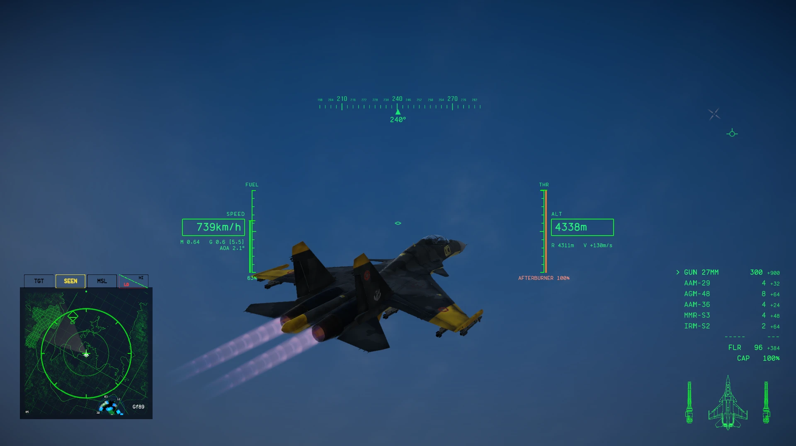
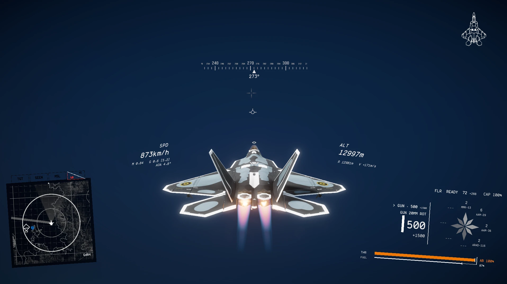
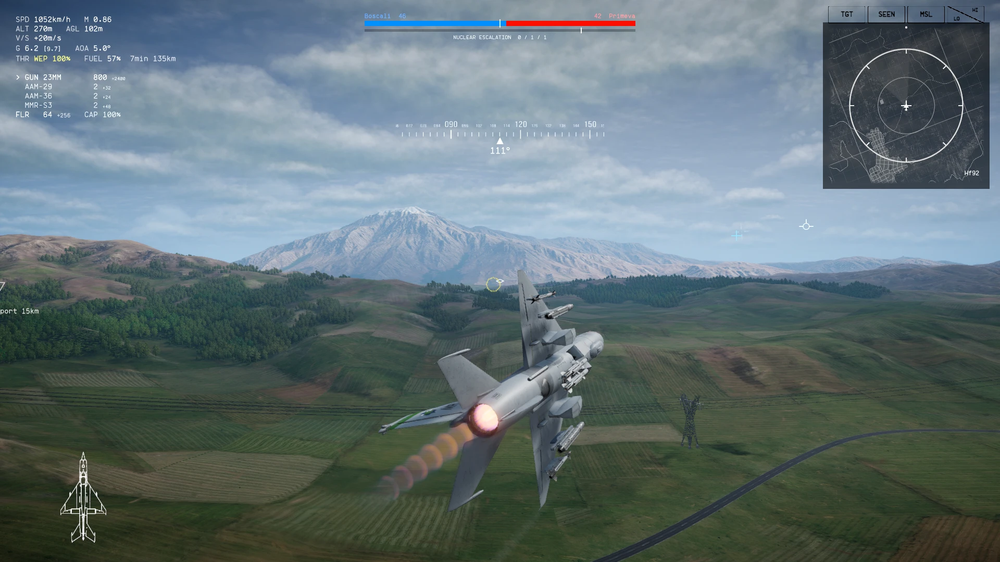
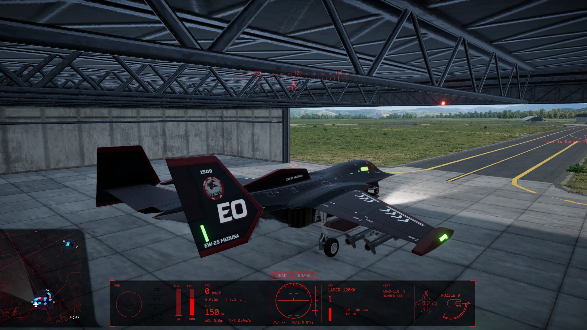

# UI Plus

**A HUD overhaul for Nuclear Option: four HUD styles, and an in-game editor that makes almost everything on screen yours to move, resize, restyle or hide.**

> **Beta.** UI Plus is being tested before it goes on NOMM (planned for December). Bug reports, screenshots and layout ideas are very welcome: [open an issue](https://github.com/deworadityapanji-ai/UIPlus/issues).

[**Download the latest release**](https://github.com/deworadityapanji-ai/UIPlus/releases)

---

## HUD styles

| Style | Inspired by | In short |
|---|---|---|
| **Arcade** | Ace Combat | Clean corners, speed and altitude boxes, weapon list beside the aircraft silhouette, missile arcs |
| **Wingman** | Project Wingman | Slanted readouts, the HULL throttle and fuel bar, the weapon star |
| **Dashboard** | Cockpit instrument panels | Every instrument in one strip along the bottom, made to glance at |
| **Thunder** | War Thunder | A dense text readout, faction score bar, map in the top-right corner |
| **Native** | The game itself | The game's own HUD, with your positions |

On the **Wingman** weapon star, **LINK** and **AUTO** appear when the loaded gun or turret stations support them and there is room. The vanilla **Link Guns** and **Toggle Turret Control** keybinds always work.

Aircraft with a reversible pusher, such as the Ibis, show forward, idle, and reverse pusher throttle in the custom HUD styles. Native and Plus use the stock pusher gauge with the right camera-attached instruments.
**Hover drift indicator** is on by default and can be toggled under **UI PLUS → HUD ELEMENTS** for the replacement HUD styles.

| Arcade | Wingman |
|---|---|
|  |  |
| **Thunder** | **Dashboard** |
|  |  |

## The editor

Open it from the **UI PLUS** tab in the game's settings (or from Configuration Manager), then:

- **Move** anything by dragging it, or select it and use the arrows. Hold **Shift** and drag to move the selected element from anywhere on screen.
- **Resize and rotate** with the square and ↻ handles on the selected element.
- **Show or hide** any element from the list.
- **Skins:** many elements have alternative looks. For example, the weapon list (Arcade list or Wingman cluster), speed and altitude boxes, map backing, damage silhouette, targeting screen, RWR alerts and kill feed.
- **Extras:** add elements from another style. For example, Arcade's fuel tapes in Wingman, Thunder's data block in Arcade, or the Wingman star on its own.

Every style keeps its own saved layout. **Reset** puts the style you're editing back to its defaults, and **Reset element** does the same for one element.

## Also included

- The HUD in **chase, cockpit and orbit** views (each can be switched off).
- **Show in HUD view** defaults to on and uses your UI Plus layout in ArcadeCam's nose camera. Requires ArcadeCam with HUD view support.
- **Targeting camera feed** on the HUD.
- **Kill feed**, mission banners and subtitles. The custom kill feed has **All**, **Mine** and **Off** modes under **UI PLUS → HUD ELEMENTS**. **Show intercepted munitions** and **Show players joining/leaving** are on by default. **Mine** includes intercepts you make and intercepted munitions you fired or that were aimed at you. Join and leave notices appear in both **All** and **Mine**. Native and Plus use the game's log.
- **Capacitor display** in **UI PLUS → HUD ELEMENTS** defaults to **Text (CAP %)**. Choose **Bar with kJ** for stored energy, capacity and a charge or drain arrow.
- **Minimap zoom** (bind "UI Plus Minimap Zoom" in Flight Controls).
- **Hide HUD** hotkey (bind "UI Plus Hide HUD"): one press hides the whole HUD while flying, for screenshots and clean views.
- **Missile arcs:** Ace Combat-style red arcs around your aircraft showing where incoming missiles come from, growing as they close in. Hidden in player-versus-player games.
- **High contrast:** a soft dark halo behind HUD text keeps it readable over bright sky (Off / Soft / Strong).
- **Steady HUD** (from SteadyHudMarkers by musket golfer): target markers no longer sway in third person, the HUD centre stays upright, and the compass can follow the camera.
- **Fix for a game bug:** the target arrow pointed the wrong way when your target was behind you.

## Main menu styles

Under **Settings → UI PLUS → MAIN MENU**, choose **Bottom bar**, **Side rail**, **Minimal corner**, or **Vanilla**. Bottom bar is the default for new installs and puts the controls in one horizontal strip, with the logo and pilot name in the top corners. Existing installs keep their saved style. Vanilla restores the stock menu. Side rail groups the original title buttons under PLAY, CREATE, and MORE. Minimal corner puts the text-only list at the bottom left. Custom styles include MissionSaveState and Join LAN Button entries when those mods add them.

Custom styles default to auto-hiding tips, showing the logo, and collapsing version and links into a clickable version label. Move the mouse to a hidden panel's screen edge to reveal it. Auto-hidden panels stay visible while a gamepad is the last input. Style changes, including a return to Vanilla, apply when you close settings on the title screen.
Set **Accent colour** to **Green** (default), **Amber**, **White**, or **HUD colour** to change the custom styles' highlight bars.
Set **Menu side** to **Left** (default) or **Right** to move the custom menu controls to that side. The change applies when you close settings on the title screen.

## Custom backgrounds

Put PNG, JPG, JPEG, MP4, or WebM files in `BepInEx/plugins/UIPlus/Backgrounds/`. UI Plus creates the folder and a short README on first use, and scans it when a new title-menu session starts, including in Vanilla style. An empty folder uses the game's art. One image stays on screen, one video loops, and multiple files play in shuffled order. Videos run to the end before the next item. If a video doesn't play, re-encode it to H.264 MP4 with AAC audio. WebM support depends on Unity's decoder, with VP8 the intended format.

Playback and video sound continue across the title, Singleplayer mission selection, and the multiplayer browser and menu-side lobby. They keep running underneath Settings, Workshop, and mission customisation. Screens without a recognised backdrop keep their stock art. Entering a mission, the mission editor, or the Encyclopedia stops playback. Returning to the title afterwards starts a new playlist and rescans the folder.

Releases include the default [Nuclear Option title video](https://www.youtube.com/watch?v=tATPDavr1fo) by [At0micVen0m_ (Atomic)](https://www.youtube.com/@At0micVen0m_), used with permission. Delete or replace `Nuclear Option Title - At0micVen0m_.mp4` in `Backgrounds`, or turn off **Custom background** to use the game's art.

Under **Settings → UI PLUS → MAIN MENU**, **Custom background** and **Video sound** are on by default. **Open folder** opens the background folder in Explorer, and the status shows how many images and videos were found and any files rejected during the current menu visit. **Image duration** defaults to 12 seconds (3–120). **Background transition** offers **Crossfade** (default) or **Fade through black**, and **Fade duration** defaults to 1 second (0.2–3). Images can be up to 64 MB and 8192 pixels on their longest side. UI Plus downscales stills larger than 4096 pixels for display.

**Video audio output** defaults to **Smooth**, which uses Unity's Direct output to help audio continue through loading stalls and follows the game's Music and Master sliders. Switch to **Mixer** for the game's music channel and its processing. The output choice applies when the next video is prepared. To apply it to a looping video, turn **Custom background** off and back on. Decoder and device behavior can affect playback in Smooth mode. Stock menu music returns when the video ends or video sound is turned off.

## Installation

1. Install [BepInEx 5](https://github.com/BepInEx/BepInEx/releases) for Nuclear Option, if you haven't already.
2. Download `UIPlus-vX.Y.Z-beta.zip` from the [releases page](https://github.com/deworadityapanji-ai/UIPlus/releases).
3. Extract the `UIPlus` folder into `Nuclear Option/BepInEx/plugins/`.
4. Start the game, open **Settings → UI PLUS**, and pick a HUD style.
   UI Plus follows the game's primary HUD colour in **Settings → Accessibility**.

To update, replace the `UIPlus` folder. Your settings and layouts are kept (they live in `BepInEx/config/UIPlus.cfg`).

## Works with other mods

UI Plus needs none of these, but it works with each of them when installed. The **Mod compatibility** box in the UI PLUS tab shows which ones it found and whether each is working, with a switch to turn each integration off.

| Mod | What UI Plus does with it |
|---|---|
| **ArcadeCam** | HIT / MISS / DESTROYED callouts; the targeting screen hides during ArcadeCam's weapon camera; the UI Plus HUD shows in ArcadeCam's HUD view |
| **MissionSaveState** | Its Continue and Load Save buttons fit into the custom main menu styles, at the top of PLAY. The buttons and the saving itself come from MissionSaveState |
| **Join LAN Button** | Its LAN buttons appear in the custom main menu styles |
| **RAH-72 Pushout (KnockPush)** | The pusher prop it adds shows as each style's PROP readout, like the Ibis |
| **KaceyTronic RWR** | The scope and its alerts follow the HUD style, and both can be moved in the editor |
| **Ace Combat Style Reloads** | Weapon reserves and reload progress on the HUD |
| **NO Missile Indicators** | Its style follows the HUD style (Project Wingman's 3D indicator in Wingman, arrows elsewhere), and its arrows step aside where the missile arcs show |
| **WSO Yappinator** | Voice lines as subtitles ([see below](#voice-line-subtitles-wso-yappinator)) |
| **NeutralQoL**, **NOAutopilot** | Their fuel overlays step aside while the Thunder style shows its own |
| **NuclearMinimap** | It runs the minimap (orientation, zoom, centring) and UI Plus leaves those to it; its cockpit map stays readable |
| **SteadyHudMarkers** | Built in as UI Plus's Steady HUD; if the standalone is installed, UI Plus leaves the job to it |

## Voice line subtitles (WSO Yappinator)

UI Plus can show what the WSO says as subtitles, but it needs to know the words. Each voice pack needs a dialogue file listing its lines.

1. Open the voice pack's folder: `BepInEx/plugins/WSOYappinator/audio/<pack name>/` (where its `.wav` files are).
2. Create a text file there whose name ends in `_dialogue.txt`, for example `mypack_dialogue.txt`.
3. Add one line per sound file:

```
<sound file name>, <Speaker>: <what is said> [<mm:ss>]
```

For example:

```
missile_1.wav, Viper: Fox two, fox two! [00:02]
missile_2.wav, Viper: Missile away. [00:02]
kill_1.wav, Viper: Splash one! [00:01]
spawn_1.wav, Viper: All systems green, let's go.
```

- **Sound file name:** exactly as the file is named in the folder.
- **Speaker** (optional): shown above the subtitle. Leave out `Speaker:` to show the line alone.
- **Duration** (optional): how long the subtitle stays, in minutes and seconds. Without it, the time is worked out from the line's length.

**Ready-made: the Galaxy voice pack.** A complete dialogue file for nikkorap's **Galaxy** voice pack (all 116 lines) is included: [examples/WSOYappinator/Galaxy/galaxy_dialogue.txt](examples/WSOYappinator/Galaxy/galaxy_dialogue.txt). Put it in `BepInEx/plugins/WSOYappinator/audio/Galaxy/`. The voice pack and its lines are nikkorap's work; the file only transcribes them for subtitles.

Restart the game after adding or changing a dialogue file. The game's log (`BepInEx/LogOutput.log`) says how many lines UI Plus loaded.

## Credits

- Split out of [ArcadeCam](https://github.com/deworadityapanji-ai/ArcadeCam), itself a fork of [ChaseCamPlus by CarloApri](https://github.com/CarloApri/NO-ChaseCamPlus). The original MIT licence is kept.
- Integrations made with the permission of the authors of Ace Combat Style Reloads (Dandy-Yak), KaceyTronic RWR (KcTries) and WSO Yappinator (nikkorap). Full details in [THIRD-PARTY-NOTICES.md](THIRD-PARTY-NOTICES.md).
- Steady HUD is built in from [SteadyHudMarkers](THIRD-PARTY-NOTICES.md) by musket golfer, with their permission.
- The Galaxy dialogue file transcribes the lines of nikkorap's Galaxy voice pack for WSO Yappinator. The voice pack and its lines are his.
- Made with substantial AI assistance.

UI Plus is a community mod, not affiliated with Shockfront Studios. The style names refer to the games that inspired them; this is not an official tie-in with any of them.

## Building from source

Requires the .NET SDK and a Nuclear Option install (path in `UIPlus/GameDir.targets`; override it in a `GameDir.local.targets` next to it). With the game closed:

```powershell
scripts/build.ps1
dotnet run --project tests/UIPlus.Tests
scripts/install-mod.ps1
```

## License

MIT. See [LICENSE](LICENSE).
